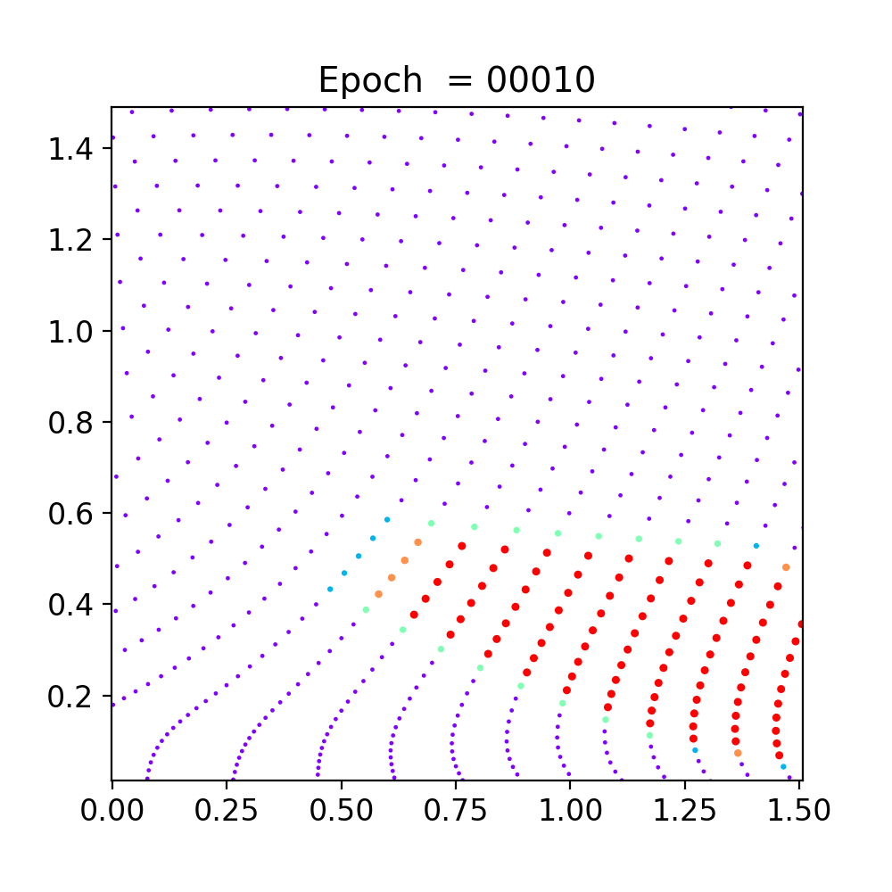
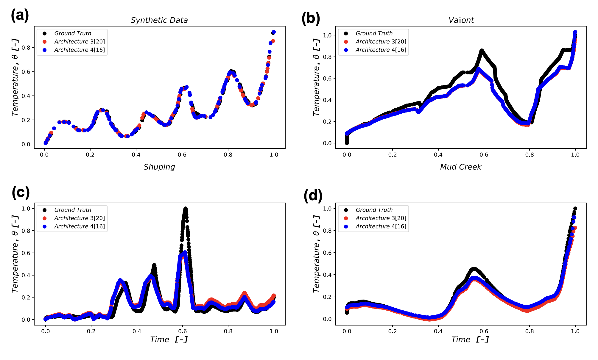
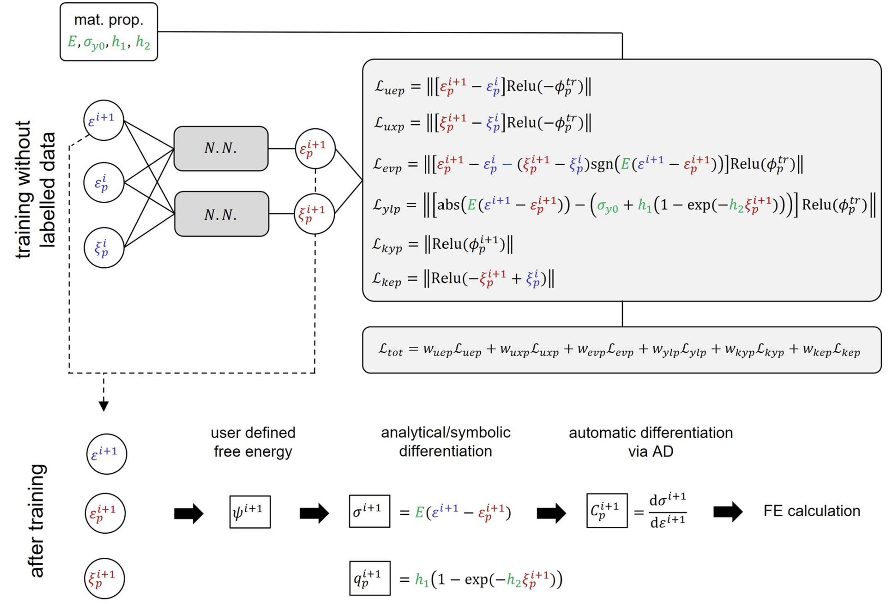
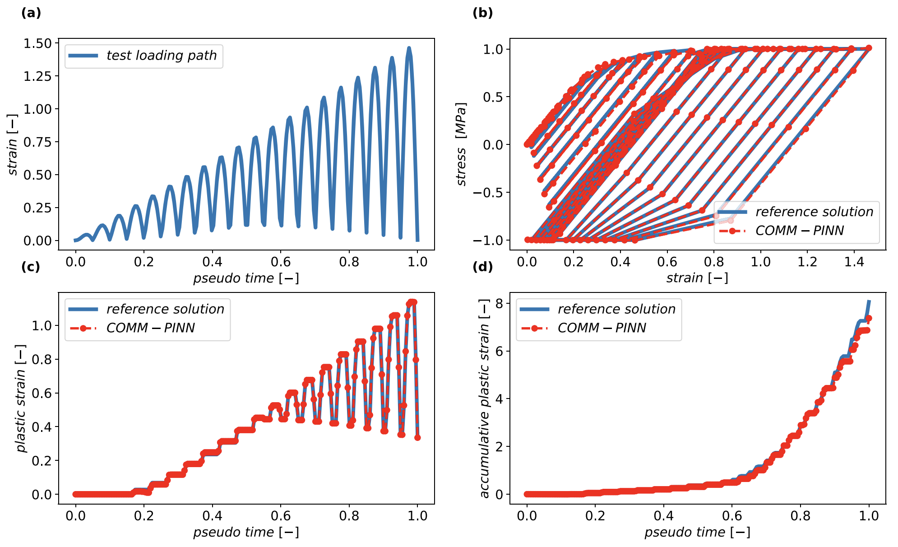

# Physics-Informed Computational Mechanics

This repository presents selected contributions from my research in
**physics-informed machine learning for computational mechanics**.

The work summarized here was developed collaboratively across research
teams at **RWTH Aachen University**, **TU Dresden**, ACCESS e.V., and
partner institutions.

My research in this area began during my master's studies at RWTH Aachen
with physics-informed neural networks for solid mechanics and heterogeneous
domains and subsequently expanded toward:

- coupled multiphysics,
- geomechanical applications,
- nonlinear constitutive modeling,
- history-dependent material behavior,
- and finite operator learning.

This repository is a **personal research showcase** of collaborative work.
It does not represent sole ownership of the associated methods, software,
or publications. Authorship and software links are provided below for
exact attribution.

---

# Collaborative Open-Source Implementations

Several implementations associated with this research program are available
through the collaborative repository:

### [phyml4e/PINNs](/phyml4e/PINNs)

The repository contains implementations and examples for:

- mixed physics-informed neural networks,
- elasticity,
- thermal problems,
- thermo-mechanical coupling,
- and constitutive-model learning through COMM-PINN.

I contributed to the development and preparation of selected research
implementations and numerical studies within this collaborative program.

The present repository does **not duplicate the team codebase**. Instead,
it provides a compact overview of the research directions, selected results,
and associated publications.

---

# 1. Mixed Physics-Informed Neural Networks

One of the early research directions was the development of a
**mixed formulation for physics-informed neural networks** in computational
mechanics.

Conventional PINNs often evaluate higher-order spatial derivatives directly
through automatic differentiation. In the mixed formulation, additional
mechanical fields such as gradients, fluxes, or stresses can be introduced
as network outputs and constrained through first-order relations.

This formulation was investigated for engineering boundary-value problems,
with particular attention to **heterogeneous domains and material
interfaces**, where field gradients and material properties may change
strongly across the domain.

The approach draws an analogy with mixed formulations in classical
numerical methods and provides an alternative way of constructing the
physics-based loss function.

### Associated publication

**S. Rezaei, A. Harandi, A. Moeineddin, B.-X. Xu, S. Reese**

*A mixed formulation for physics-informed neural networks as a potential
solver for engineering problems in heterogeneous domains:
Comparison with finite element method*

**Computer Methods in Applied Mechanics and Engineering**, 401, 115616,
2022.

DOI: `10.1016/j.cma.2022.115616`

### Open-source implementation

See:

**[phyml4e/PINNs — Elasticity](/phyml4e/PINNs/tree/main/Elasticity)**

and the associated thermal implementations in the collaborative repository.

---

# 2. Physics-Informed Neural Networks for Creeping Landslides

The methodology was subsequently applied to a real geomechanical problem:
the thermo-poro-mechanical behavior of shear bands in catastrophic
deep-seated landslides.

In this work, physics-informed neural networks were used to predict the
temperature evolution within the shear band using the governing physical
model together with available observations.

The study considered both synthetic data and field information from three
well-known landslides:

- **Vaiont**
- **Shuping**
- **Mud Creek**

The objective was to investigate whether physics-informed learning could
reproduce the thermal evolution associated with accelerating creeping
landslides and provide a computational alternative for this class of
strongly coupled physical problems.

*PINN predictions for synthetic data and the Vaiont, Shuping, and Mud Creek
landslide cases.*

This study represents one of my **first-author applications of PINNs to an
engineering problem**.

### Associated publication

**A. Moeineddin, C. Seguí, S. Dueber, R. Fuentes**

*Physics-informed neural networks applied to catastrophic creeping
landslides*

**Landslides**, 20, 1853–1863, 2023.

DOI: `10.1007/s10346-023-02072-0`

---

# 3. Mixed PINNs for Coupled Thermo-Mechanical Problems

The mixed PINN formulation was further extended to
**thermo-mechanically coupled systems and heterogeneous domains**.

The work investigated physics-informed solution strategies for stationary
multiphysics problems and considered both:

- sequential training,
- and fully coupled unsupervised training.

Particular attention was given to heterogeneous materials, hard enforcement
of boundary conditions, network architecture, training strategies, and
parametric prediction.

This development demonstrated how mixed physics-informed formulations can be
extended beyond individual PDEs toward systems containing multiple coupled
physical fields.

### Associated publication

**A. Harandi, A. Moeineddin, M. Kaliske, S. Reese, S. Rezaei**

*Mixed formulation of physics-informed neural networks for
thermo-mechanically coupled systems and heterogeneous domains*

**International Journal for Numerical Methods in Engineering**,
125(4), e7388, 2024.

DOI: `10.1002/nme.7388`

### Open-source implementation

See:

**[phyml4e/PINNs — Thermomechanic](/phyml4e/PINNs/tree/main/Thermomechanic)**

---

# 4. Physics-Informed Constitutive Learning — COMM-PINN

Another research direction focused on using physics-informed neural
networks to solve **nonlinear, path-dependent constitutive equations**.

Instead of learning material response purely from labeled stress--strain
data, the COMM-PINN approach incorporates constitutive relations,
thermodynamic constraints, and evolution equations directly into the
training process.

The neural network predicts internal constitutive quantities, while the
physics-based loss enforces the governing material relations.

*Physics-informed constitutive learning framework. Material relations and
thermodynamic constraints enter directly into the training loss, while
trained network outputs can subsequently be used to recover stresses and
consistent material quantities for numerical calculations.*

A central motivation is to replace repeated nonlinear constitutive solution
procedures by a trained model that can evaluate the material state directly
for loading paths within its training regime.

The methodology was investigated for nonlinear material models including
plasticity, hardening, damage, and history-dependent constitutive response.

## Example: Cyclic Path-Dependent Response

*Comparison of COMM-PINN predictions and reference constitutive solutions
under a non-monotonic loading history, including stress response and the
evolution of internal plastic variables.*

The example illustrates that the trained network can reproduce not only the
stress response but also the evolution of history-dependent internal
variables under complex loading.

### Associated publication

**S. Rezaei, A. Moeineddin, A. Harandi**

*Learning solutions of thermodynamics-based nonlinear constitutive material
models using physics-informed neural networks*

**Computational Mechanics**, 74(2), 333–366, 2024.

DOI: `10.1007/s00466-023-02435-3`

### Open-source implementation

See:

**[phyml4e/PINNs — COMM_PINN](/phyml4e/PINNs/tree/main/COMM_PINN)**

---

# 5. Toward Finite Operator Learning

More recent collaborative research has extended this direction beyond
classical PINNs toward **Finite Operator Learning (FOL)**.

FOL combines ideas from:

- neural operator learning,
- physics-informed machine learning,
- and the finite element method.

Instead of solving a single boundary-value problem, the objective is to
learn a **parametric solution operator** capable of predicting solutions
over a family of PDE problems while enforcing the governing physics.

The numerical discretization is used directly in the construction of the
physics-based loss, creating a close connection between machine learning
and classical computational mechanics.

### Associated publication

**S. Rezaei, R. Najian Asl, K. Taghikhani, A. Moeineddin,
M. Kaliske, M. Apel**

*Finite Operator Learning: Bridging neural operators and numerical methods
for efficient parametric solution and optimization of PDEs*

**Finite Elements in Analysis and Design**, 254, 104506, 2026.

DOI: `10.1016/j.finel.2025.104506`

## Current Folax Framework

The later software development of FOL has evolved into the JAX-based
**Folax** framework maintained by the Neural Mechanics Lab:

### [Neural-Mechanics-Lab/folax](/Neural-Mechanics-Lab/folax)

I contributed to the **earlier research and software development associated
with the FOL work** and am a coauthor of the methodological study listed
above.

The current Folax/JAX implementation represents a later development of the
software and is maintained by the Neural Mechanics Lab; I have not
contributed to the current version of that codebase.

This distinction is included here to clearly separate my contribution to
the research direction from authorship of the present Folax implementation.

---

# Research Progression

The work summarized in this repository reflects a progression from solving
individual engineering PDE problems toward increasingly general
physics-based learning frameworks:

**Mixed PINNs for mechanics**

↓  

**Heterogeneous and multiphysics systems**

↓  

**Physics-informed constitutive learning**

↓  

**Path-dependent nonlinear material response**

↓  

**Finite operator learning for parametric PDEs**

Across these developments, the common objective is to combine
**mechanics-based physical structure** with machine-learning models rather
than relying purely on data-driven approximation.

---

# Selected Publications

### 2026

**S. Rezaei, R. Najian Asl, K. Taghikhani, A. Moeineddin,
M. Kaliske, M. Apel**

*Finite Operator Learning: Bridging neural operators and numerical methods
for efficient parametric solution and optimization of PDEs*

**Finite Elements in Analysis and Design**, 254, 104506.

DOI: `10.1016/j.finel.2025.104506`

---

### 2024

**S. Rezaei, A. Moeineddin, A. Harandi**

*Learning solutions of thermodynamics-based nonlinear constitutive material
models using physics-informed neural networks*

**Computational Mechanics**, 74(2), 333–366.

DOI: `10.1007/s00466-023-02435-3`

---

**A. Harandi, A. Moeineddin, M. Kaliske, S. Reese, S. Rezaei**

*Mixed formulation of physics-informed neural networks for
thermo-mechanically coupled systems and heterogeneous domains*

**International Journal for Numerical Methods in Engineering**,
125(4), e7388.

DOI: `10.1002/nme.7388`

---

### 2023

**A. Moeineddin, C. Seguí, S. Dueber, R. Fuentes**

*Physics-informed neural networks applied to catastrophic creeping
landslides*

**Landslides**, 20, 1853–1863.

DOI: `10.1007/s10346-023-02072-0`

---

### 2022

**S. Rezaei, A. Harandi, A. Moeineddin, B.-X. Xu, S. Reese**

*A mixed formulation for physics-informed neural networks as a potential
solver for engineering problems in heterogeneous domains:
Comparison with finite element method*

**Computer Methods in Applied Mechanics and Engineering**, 401, 115616.

DOI: `10.1016/j.cma.2022.115616`

---

# Software and Reproducibility

This repository serves primarily as a **research showcase** and does not
duplicate software already maintained through collaborative repositories.

For implementations associated with the mixed PINN, multiphysics, and
constitutive-learning studies, see:

### [phyml4e/PINNs](/phyml4e/PINNs)

For the current JAX-based development of Finite Operator Learning, see:

### [Neural-Mechanics-Lab/folax](/Neural-Mechanics-Lab/folax)

The exact software contribution varies between projects. Publication
authorship and the linked collaborative repositories should be used for
project-specific attribution.

---

# Technical Topics

`Computational Mechanics` · `Scientific Machine Learning` ·
`Physics-Informed Neural Networks` · `Mixed PINNs` ·
`Constitutive Modeling` · `Multiphysics` · `Nonlinear Mechanics` ·
`Plasticity` · `Inverse Problems` · `Finite Operator Learning`

---

# Contact

**Ahmad Moeineddin**

Computational Mechanics & Scientific Computing  
Institute of Structural Analysis  
TU Dresden

- [GitHub](https://github.com/Ahmadmoein)
- [LinkedIn](https://www.linkedin.com/in/ahmad-moeineddin-599837175/)
- [Google Scholar](https://scholar.google.com/citations?user=eOQXTPIAAAAJ&hl=en)
- [ORCID](www.linkedin.com/in/ahmad-moeineddin-599837175)
